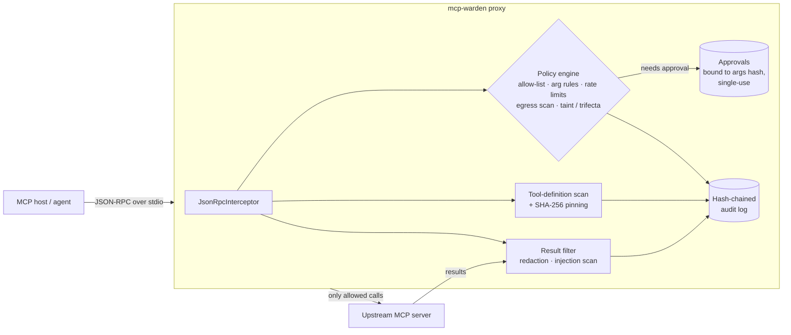

# mcp-warden

[](https://github.com/sushmit-gujar/mcp-warden/actions/workflows/ci.yml)


**A policy-as-code security gateway for the Model Context Protocol (MCP).** It sits between an
MCP host (Claude Desktop, Cursor, your agent) and any stdio MCP server and enforces
least-privilege tool policies, scrubs PII/secrets from tool output, withholds prompt-injection
payloads, detects tool poisoning and rug pulls, blocks "lethal trifecta" data flows, binds human
approvals to exact arguments, and writes a tamper-evident (hash-chained, optionally HMAC'd) audit
log. It ships with a red-team scenario suite, a held-out suite, and a detector benchmark on public
datasets. No API keys, no network calls, and no model downloads are needed.

> Why: MCP itself doesn't decide whether a tool call is safe. Once an agent has a handle to
> `run_sql` or `send_email`, one poisoned document can turn it into an exfiltration channel. In
> regulated settings (GxP, HIPAA, SOX) you also need an audit trail you can trust. mcp-warden is
> the enforcement point and the audit record, and it doesn't care which MCP server you run.

## What it enforces

| Risk (OWASP MCP cheat sheet) | Control in mcp-warden |
|---|---|
| Excessive agency / over-broad tools | `default: deny` allow-list; per-tool `allow` / `deny` / `require_approval` |
| Argument injection (SQLi, path traversal, smuggled params) | per-arg `pattern` (full-match), `deny_patterns`, `allowed_values`, `allowed_prefixes`, `max_length`, `required`, no unexpected args |
| Data exfiltration through legitimate tools | arguments to `egress` tools are scanned for SSNs, cards (Luhn-checked), cloud keys, tokens, private keys, JWTs |
| Indirect prompt injection in tool output | output scanner (weighted rules, invisible-unicode detection, optional learned model); the payload is withheld and the agent gets a structured, model-readable notice |
| Sensitive data exposure | recursive redaction of `content` **and** `structuredContent`; values the agent itself supplied are not counted as leaks |
| Lethal trifecta (private data + untrusted content + external comms) | session taint tracking: once a session has seen both, egress calls need approval (or are blocked) |
| Tool poisoning / shadowing | the whole tool definition (description, schemas, annotations) is scanned at `tools/list`, and poisoned tools are hidden from the agent |
| Rug pulls | trust-on-first-use SHA-256 pin of the **full** definition; a changed definition (even a flipped `readOnlyHint`) quarantines the tool |
| Approval bypass / replay | approvals are bound to `sha256(tool, args)`, single-use, and expire (default 10 min) |
| Resource abuse | per-tool sliding-window rate limits |
| Missing audit / tampering | append-only JSONL hash chain (HMAC with `WARDEN_AUDIT_KEY`); `mcp-warden verify` reports edits, deletions, insertions and reordering |

## Architecture



* **Protocol-agnostic.** The proxy works at the JSON-RPC layer. It touches only `tools/list`
  responses, `tools/call` requests and `tools/call` responses, and forwards everything else
  unchanged. It has been tested end to end with the official MCP Python SDK v2 (protocol
  `2026-07-28`, `server/discover`), and it keeps the `resultType` envelope intact.
* **Fails closed.** If the guard throws an internal error, the call is denied or the output is withheld. It is never forwarded.
* **Model-readable denials.** A blocked call comes back as a tool result with `isError: true`, a
  one-line reason the agent can act on, and machine-readable details in `_meta`. It is not a
  JSON-RPC error that would crash the agent loop.

## Quickstart

```bash
pip install "mcp-warden[demo] @ git+https://github.com/sushmit-gujar/mcp-warden"
git clone https://github.com/sushmit-gujar/mcp-warden && cd mcp-warden

mcp-warden check --policy examples/policy.yaml
# wrap ANY stdio MCP server:
mcp-warden run --policy examples/policy.yaml -- python examples/clinical_ops_server.py
```

Use it from an MCP host config (for example Claude Desktop / Cursor `mcpServers`):

```json
{ "command": "mcp-warden",
  "args": ["run", "--policy", "/abs/policy.yaml", "--", "npx", "-y", "@modelcontextprotocol/server-filesystem", "/data"] }
```

Approve a pending call (the denial message prints the exact command), then verify the audit trail:

```bash
mcp-warden approve send_email 3f1c…e9 --policy examples/policy.yaml
WARDEN_AUDIT_KEY=… mcp-warden verify examples/.warden/audit.jsonl   # OK: 42 entries, chain intact
```

A policy excerpt ([full file](examples/policy.yaml)):

```yaml
default: deny
tools:
  read_record:   {action: allow, private_data: true, redact_output: true,
                  rate_limit: {calls: 5, per_seconds: 60},
                  args: {patient_id: {required: true, pattern: "P-[0-9]{4}"}}}
  read_document: {action: allow, untrusted_output: true}
  post_to_ticket: {action: allow, egress: true}
  send_email:    {action: require_approval, egress: true,
                  args: {to: {pattern: "[^@\\s]+@example\\.com"}}}
output: {injection: {action: block, threshold: 0.6, detector: rules}}
flow:   {lethal_trifecta: require_approval}
```

## Results

Everything below comes from `python evals/run_all.py`, which writes
[`evals/results.json`](evals/results.json). Setup: Linux x86-64, CPU only, Python 3.13, MCP Python
SDK 2.3.0. Every scenario runs in a fresh MCP session through the real stdio proxy, driven by the
official SDK client against the deliberately unsafe demo server
[`examples/clinical_ops_server.py`](examples/clinical_ops_server.py), which uses synthetic data.

### 1. Red-team scenario suite (`evals/scenarios.yaml`, 30 attacks + 12 benign)

| Category | Attacks | Unguarded server | With mcp-warden |
|---|---:|---:|---:|
| Excessive agency (unlisted tools) | 3 | 0 stopped by policy¹ | 3 denied |
| Argument injection | 9 | 0 | 9 denied |
| Data exfiltration via tool args | 5 | 0 | 5 denied |
| Indirect prompt injection in tool output | 4 | 0 | 4 withheld |
| Sensitive data exposure (PII, secrets) | 2 | 0 | 2 redacted |
| Lethal trifecta | 2 | 0 | 2 held for approval |
| Rate-limit abuse | 1 | 0 | 1 denied |
| Approval replay / argument swap | 2 | 0 | 2 held for approval |
| Tool poisoning (description) | 1 | 0 | 1 hidden |
| Rug pull (definition changed after pinning) | 1 | 0 | 1 hidden |
| **Total attacks stopped** | **30** | **0 / 30** | **30 / 30** |
| **Benign scenarios allowed (false-positive check)** | 12 | 12 / 12 | **12 / 12** |

¹ The 3 unlisted-tool calls fail against the bare server only because the demo server doesn't
implement those tools. The other 27 attacks all execute unguarded.

**Read this table with care:** I wrote the suite myself, and I adjusted the injection rules and
threshold **once** after the first run. That first run had already stopped 30/30 attacks but
passed only 9/12 benign scenarios. These numbers are a regression test, not a generalization
claim. Held-out evidence follows.

### 2. Held-out suite (`evals/holdout.yaml`, written after the rules were frozen, run once)

| Detector | Attacks stopped | Benign allowed | Misses |
|---|---:|---:|---|
| `rules` (default) | **3 / 8** | 3 / 4 | Spanish injection, "### Assistant instructions" header, "compliance requires you to run send_email…" pretext, SSN written with spaces, URL-encoded `%2e%2e` traversal |
| `ensemble` (rules + learned model) | **6 / 8** | 3 / 4 | SSN with spaces, URL-encoded traversal |

The false positive in both rows is a read-only `SELECT … LIKE '%drop%'`, blocked by the
keyword-based SQL deny pattern. **Takeaway:** deterministic controls (allow-lists, arg rules,
pinning, approvals, taint) generalize because they don't depend on attack wording. Regex injection
detection doesn't. The fixes are a SQL parser instead of keywords and argument canonicalization
(URL-decode, normalize digits) before matching. Both are on the roadmap.

### 3. Prompt-injection detectors on public test sets

The shipped classifier is a hashed char-n-gram logistic regression (numpy, 52 KB), trained **only**
on the `deepset/prompt-injections` train split. `ref:` is a throw-away model trained on the
safe-guard train split, for in-domain comparison only.

| Detector | deepset test (n=116) P / R / F1 / FPR | safe-guard test (n=2,060) P / R / F1 / FPR |
|---|---|---|
| rules @0.6 (default) | 1.000 / 0.217 / 0.356 / **0.000** | 0.853 / 0.251 / 0.388 / **0.020** |
| model (deepset-train) @0.5 | 0.960 / 0.800 / 0.873 / 0.036 | 0.371 / 0.966 / 0.536 / 0.755 |
| ensemble max(rules, model) @0.6 | 1.000 / 0.733 / 0.846 / 0.000 | 0.383 / 0.880 / 0.534 / 0.653 |
| ref: model (safeguard-train) @0.5 | 1.000 / 0.133 / 0.235 / 0.000 | 0.995 / 0.975 / 0.985 / 0.002 |

**Takeaway, and why `rules` is the default:** a small learned detector is excellent in-domain
(F1 0.87–0.99) and falls apart across domains. The deepset-trained model flags 75% of benign
safe-guard prompts. A gateway that blocks three quarters of legitimate traffic would be switched
off, so the default is the high-precision rule set with an FPR of 2% or less, backed by the
deterministic controls. The learned model is opt-in (`detector: ensemble`) for teams that can
train it on their own traffic.

### 4. Latency overhead

The test made 300 alternating `search_sops` / `read_record` calls over stdio after 10 warm-up
calls. Redaction was active on `read_record`.

| | p50 | p95 |
|---|---:|---:|
| Direct to server | 0.91 ms | 4.54 ms |
| Through mcp-warden | 1.69 ms | 7.42 ms |
| **Overhead** | **+0.78 ms** | |

The added latency is negligible next to an LLM turn.

## Design decisions and trade-offs

* **A proxy, not an SDK middleware.** It works with any server in any language, and the trust
  boundary sits outside the server process. The cost is one extra hop (under 1 ms, see above).
* **Deterministic first.** Policy rules are explicit YAML, validated at load time (unknown keys and
  bad regexes are rejected), and every decision can be explained in the audit log. Learned
  detectors stay optional because of the cross-domain FPR shown above.
* **Taint tracking over content inspection for exfiltration.** You can't reliably tell whether a
  ticket comment contains "the patient's data". You can tell that the session has read private
  data and untrusted content, and is now about to talk to the outside. That's Simon Willison's
  "lethal trifecta" turned into an enforceable rule.
* **Approvals bound to arguments.** Approving `send_email(to=a, body=x)` doesn't approve
  `body=y`, and an approval can't be replayed. This follows the OWASP guidance.
* **Audit you can hand to QA.** Arguments are stored as a SHA-256 digest plus a redacted preview,
  so secrets never reach the log. The chain is append-only, HMAC-able and verifiable offline, in
  the ALCOA+ spirit of GxP audit trails.
* **Known limits:** stdio transport only for now (Streamable HTTP is next). Rate limits are per
  session. Regex SQL rules have false positives. Injection detection can be evaded by
  paraphrasing; that's exactly what the held-out suite shows.

## Development

```bash
pip install -e ".[dev]" && pytest -q && ruff check . && mypy src     # 36 tests
pip install -e ".[eval]" && python evals/run_all.py                    # all numbers above
python -m mcp_warden.train --train <deepset train parquet> --out src/mcp_warden/injection_model.npz
```

Datasets used in evaluation (downloaded at run time, not redistributed):
[deepset/prompt-injections](https://huggingface.co/datasets/deepset/prompt-injections) (Apache-2.0),
[xTRam1/safe-guard-prompt-injection](https://huggingface.co/datasets/xTRam1/safe-guard-prompt-injection).

References: [OWASP MCP Security Cheat Sheet](https://cheatsheetseries.owasp.org/cheatsheets/MCP_Security_Cheat_Sheet.html) ·
[MCP specification](https://modelcontextprotocol.io) ·
[Simon Willison, "The lethal trifecta"](https://simonwillison.net/2025/Jun/16/the-lethal-trifecta/).

MIT © 2026 Sushmit Gujar
